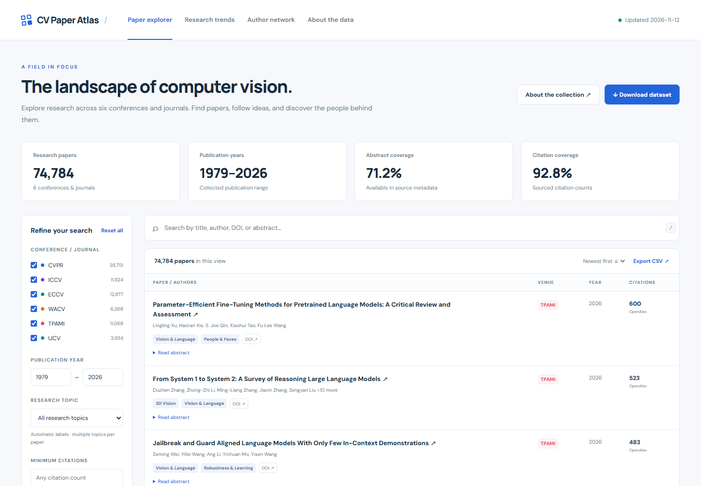

# CV Paper Atlas

Computer Vision 논문 **74,784편 · 1979–2026**을 검색하고, 연도별 연구 추이와 공저자 관계를 살펴보는 정적 웹 애플리케이션입니다.

대상: **CVPR · ICCV · ECCV · WACV · TPAMI · IJCV**. 수집한 실제 데이터로 검색 화면, 통계, 그래프와 다운로드 파일을 함께 생성합니다.



## 현재 데이터

산출물 생성: **2026-11-12**. 원본 조회일과 인용수 조회일은 각 레코드 및 coverage ledger에 기록합니다.

| Venue | 수집 연도 | 논문 | 초록 확보율 | 인용수 확보율 |
|---|---:|---:|---:|---:|
| CVPR | 1988–2026 | 28,713 | 85.0% | 85.1% |
| ICCV | 1988–2025 | 11,824 | 93.6% | 98.6% |
| ECCV | 1990–2026 | 12,877 | 0.3% | 93.3% |
| WACV | 1992–2026 | 6,368 | 98.7% | 99.4% |
| TPAMI | 1979–2026 | 11,068 | 98.8% | 99.6% |
| IJCV | 1987–2026 | 3,934 | 13.3% | 100.0% |
| **전체** | **1979–2026** | **74,784** | **71.2%** | **92.8%** |

‘전체’는 위 여섯 venue의 수집된 corpus입니다. Computer Vision의 모든 학회·저널·arXiv를 포함한다는 뜻은 아닙니다. DBLP에 색인된 본학회 자료는 총건수와 페이지네이션 결과를 대조했습니다. 출처의 미색인·지연 반영 때문에 실제 출판물 전체와 차이가 날 수 있습니다.

## 기능

- 제목·저자·DOI·확보된 초록 검색, venue·연도·주제·최소 인용수 필터
- 최신순·인용순·제목순 정렬, 페이지네이션, 필터 결과 CSV 내보내기
- 초록 펼쳐보기, 공식 논문·DOI·공개 PDF 링크
- 연도별 누적 막대그래프와 연간 편수 표
- 상위 400개 저자명의 공저 관계; 표시 인원·최소 공저 편수 조절
- 출처·확보율 안내 및 XLSX, CSV.gz, JSONL.gz 전체 다운로드
- 모바일 화면, 키보드 검색 단축키 `/`, 검색 조건 URL 공유

## 실행

Python 3.12 이상을 권장합니다. 미리 생성한 웹 파일을 열 때는 아래 서버만 있으면 됩니다.

```sh
python -m http.server 8765 --bind 127.0.0.1
```

브라우저: http://127.0.0.1:8765 . JSON을 fetch하므로 `file://`로 직접 열지 않습니다. 별도 애플리케이션 서버·데이터베이스·프런트엔드 빌드는 필요하지 않습니다. GitHub Pages 등 정적 호스팅에도 동일한 파일을 사용할 수 있습니다.

## 재수집과 빌드

```sh
pip install -r requirements.txt
python pipeline/collect_dblp.py
python pipeline/collect_cv.py --only official
python pipeline/collect_cv.py --only crossref
python pipeline/build_cv.py
python pipeline/enrich_openalex.py
python pipeline/build_cv.py
python pipeline/validate_cv.py
```

수집기는 `.cache/cv/`의 응답을 재사용합니다. 최신 자료를 다시 조회하려면 각 수집 명령에 `--refresh`를 추가합니다. OpenAlex의 공개 할당량이 부족하면 `OPENALEX_API_KEY` 환경변수를 설정하고 재실행할 수 있습니다. API 키는 데이터·로그·브라우저에 저장하지 않습니다. 네트워크 실패는 조용히 0건으로 바꾸지 않고 명시적으로 보고합니다.

저장된 snapshot만으로 재생성:

```sh
python pipeline/build_cv.py
```

## 수집·정제 원칙

1. **DBLP SPARQL**: venue stream과 본학회 label을 명시적으로 제한합니다. 저자 순서와 DBLP 연구자 식별자를 보존합니다. CVPR/ICCV/ECCV/WACV 워크숍과 CVPR Findings는 제외합니다. 초기 WACV의 본행사는 명칭에 Workshop이 있어도 포함합니다.
2. **CVF / ECVA**: 공식 논문 목록, 저자, 논문 페이지와 PDF 링크를 수집합니다. DOI가 없는 논문도 유지합니다.
3. **Crossref**: 저널 ISSN과 정확한 proceedings 이름으로 수집합니다. 예상 등록 건수와 실제 조회 건수를 대조합니다. 쉼표가 있는 옛 proceedings는 제목을 정확히 재검증하는 검색 경로를 사용합니다.
4. **OpenAlex**: 100개 DOI씩 조회하고 반환된 DOI가 정확히 같은 경우만 초록과 인용수를 반영합니다. 다른 DOI로 연결된 결과는 제외하며 batch별 ledger에 남깁니다.
5. 같은 DOI 및 DBLP가 명시한 DOI 별칭은 병합합니다. DOI 없는 공식 논문은 동일 venue·연도·정규화 제목·겹치는 저자가 있을 때 병합합니다. 다른 DOI의 학회 원본과 저널 확장본은 구분합니다.
6. 인용수는 **OpenAlex 우선, Crossref 보완**이며 출처별 값의 의미가 다릅니다. 알 수 없는 값은 `null`/`N/A`, 출처가 반환한 0은 0으로 유지합니다. Google Scholar나 Semantic Scholar 수치로 표시하지 않습니다.
7. 주제는 제목과 확보된 초록의 **키워드 규칙에 의한 다중 분류**입니다. 공식 세션 분류나 검증된 모델 예측이 아닙니다. 공저자 화면은 이름으로 집계하므로 동명이인이 합쳐질 수 있습니다.

## 데이터와 검증

- [전체 XLSX](downloads/cvpaper_atlas.xlsx) — summary, papers, venue별 시트
- [전체 CSV.gz](downloads/cvpaper_atlas.csv.gz), [전체 JSONL.gz](downloads/cvpaper_atlas.jsonl.gz)
- [집계 snapshot](data/summary.json), [수집 근거 ledger](data/coverage.json)
- [수집 보고서](docs/DATA_REPORT.md), [브라우저 검증 기록](docs/browser-qa.json)

논문별 핵심 필드: `id`, `venue`, `year`, `title`, `authors`, `author_ids`(있는 경우), `doi`, `url`, `pdf_url`, `abstract`, `topics`, `citation_count`, `citation_source`, `citation_updated`, `sources`.

```sh
python -m unittest discover -s pipeline -p test_cv.py -v
python pipeline/validate_cv.py
```

선택적 브라우저 검증(로컬 서버를 실행한 상태):

```sh
pip install -r requirements-dev.txt
python -m playwright install chromium
python pipeline/smoke_browser.py
```

GitHub Actions는 push/PR 시 회귀 테스트, 데이터 일관성 검사와 JavaScript 문법 검사를 실행합니다. 자동 재수집 일정은 설정되어 있지 않습니다.

## GitHub Pages

Pages 배포 설정: [pages.yml](.github/workflows/pages.yml). 저장소의 Settings → Pages에서 GitHub Actions를 활성화하면 `main`에 push할 때 검증을 통과한 웹사이트를 자동 배포합니다. Actions 화면에서 수동 실행할 수도 있습니다.

배포 구성에는 HTML·CSS·JavaScript, 검색 데이터, 출처 ledger와 다운로드 파일만 포함됩니다. 수집용 Python 코드, 원본 수집 snapshot, 캐시와 Git 이력은 사이트에 포함되지 않습니다.

배포된 사이트 검증:

```sh
python pipeline/smoke_browser.py --base-url https://oweixx.github.io/cvpaper-atlas/ --output-dir .cache/pages-qa
```

GitHub Free에서는 공개 저장소의 Pages를 사용할 수 있습니다. 비공개 저장소에서 Pages를 사용하려면 이를 지원하는 요금제가 필요합니다. [GitHub 공식 안내](https://docs.github.com/en/pages/getting-started-with-github-pages).

## 출처와 프로젝트 이력

- 프로젝트 출발점: [gisbi-kim/robopaper-atlas](https://github.com/gisbi-kim/robopaper-atlas), commit `c4521736a51637d03cf728eb8a411d989faa0d7d`.
- CV 버전은 별도 수집 파이프라인과 화면을 작성하고 로봇 논문·캐시·페이지를 교체했습니다. 새 저장소의 첫 커밋은 CV 결과만 담으며 원본의 대용량 Git 이력을 포함하지 않습니다. 로컬 원본 `main` 이력은 유지됩니다.
- 데이터: [DBLP](https://sparql.dblp.org/), [CVF Open Access](https://openaccess.thecvf.com/), [ECVA](https://www.ecva.net/papers.php), [Crossref](https://www.crossref.org/), [OpenAlex](https://openalex.org/).
- 논문 PDF를 저장·재배포하지 않습니다. 논문 텍스트와 각 공급원의 자료는 해당 권리와 이용 조건을 따릅니다. 원본 저장소에 명시적인 LICENSE가 없어 원본에 새로운 이용 허락이 있다고 주장하지 않습니다.
